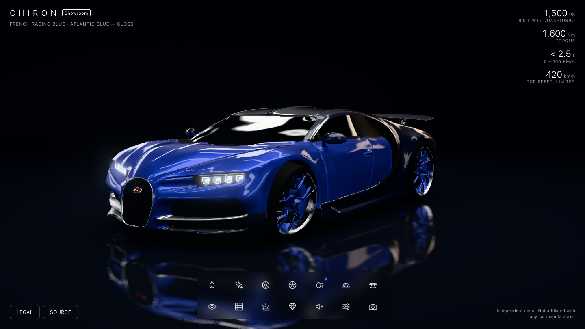
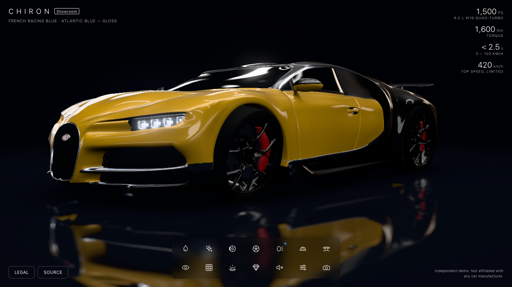
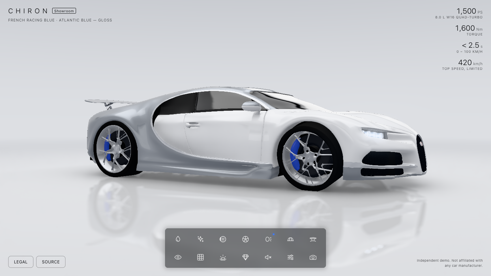
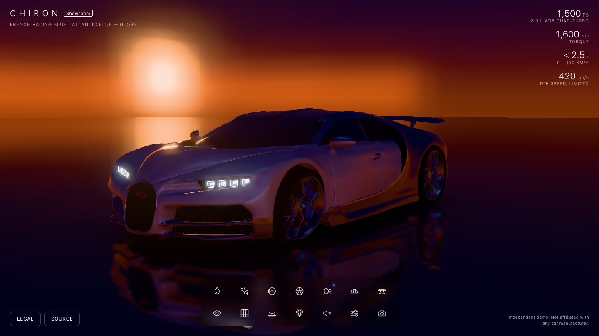

# Bugatti Chiron — Virtual Showroom

A real-time car configurator that runs entirely in the browser. Repaint a Bugatti Chiron, change
its finish, brakes and wheels, switch the lights on, raise the rear wing, and walk around it in
three environments.

**Live demo: [bugatti-chiron-showroom.vercel.app](https://bugatti-chiron-showroom.vercel.app)**

Built with Next.js and three.js. Free and open source — clone it, learn from it, build on it.



| | | |
| --- | --- | --- |
|  |  |  |

## Features

| Control | What it does |
| --- | --- |
| Paint | 12 colours for the front and rear body sections, plus two-tone presets |
| Finish | Gloss, satin, matte, iridescent pearl, chrome |
| Brake calipers | 8 colours |
| Wheels | Two-tone (spokes follow the body colour), silver, gloss black, gunmetal |
| Lights | Headlights and tail light on/off, five headlight hues |
| Livery | Twin stripe, centre band, offset stripe, in five colours |
| Rear wing | Retracted, handling, airbrake (animated) |
| Camera | Eight preset viewpoints; drag to orbit, scroll or pinch to zoom |
| Floor grid | Metre grid on the floor |
| Environment | Dark studio, light studio, dusk |
| Graphics quality | Low / medium / high; steps down automatically if the frame rate is poor |
| Sound | Synthesised ambience and interface sounds |
| Settings | Auto-rotate, exposure, bloom, lighting rotation, custom colours, reset |
| Take picture | Saves a PNG at twice the on-screen resolution |

There are no HDR files, no audio files and no textures other than one baked shadow: the lighting is
generated from emissive panels, the stripes are drawn in the paint shader, and the sound is
synthesised. The whole model is a 1.3 MB Draco-compressed glTF.

## Getting started

You need Node.js 20 or newer.

```bash
git clone https://github.com/1337Impact/bugatti-chiron-showroom.git
cd bugatti-chiron-showroom
npm install
npm run dev
```

Then open http://localhost:3000.

```bash
npm run build
npm start
```

### Deploy your own

The project needs no environment variables. Import the repository on [Vercel](https://vercel.com/new),
or from the project folder:

```bash
npx vercel --prod
```

## Project structure

```
app/                  Next.js App Router: layout, page, global styles, icon, share image
components/
  ShowroomApp.jsx     The interface: loader, intro, control bar, popovers, legal panel
  panels.jsx          The contents of each popover
  ui.jsx, icons.js    Small building blocks and the icon set
lib/
  showroom.js         The three.js scene: loading, configuration, camera, intro, post-processing
  environments.js     Image-based lighting built from emissive panels
  floor.js            Reflective floor: blurred planar reflection, baked shadow, grid
  materials.js        Material looks, paint finishes and the stripe shader
  audio.js            Web Audio synthesis
  config.js           Every colour, finish, view and default in one place
public/
  models/chiron.glb   The web-ready car
  textures/           Baked contact shadow
  draco/              Draco decoder used by the glTF loader
tools/                Blender scripts that produce the model and the shadow
bugatti/              Cleaned Blender file and the original model's credit note
```

`lib/` is plain JavaScript with no React in it. `ShowroomApp.jsx` loads it in the browser only, so
the page itself is statically generated.

## Customising

- **Colours, finishes, camera views, defaults** — edit `lib/config.js`. The interface is generated
  from those lists.
- **Material looks** — `lib/materials.js`.
- **Lighting** — each environment in `lib/environments.js` is a short list of glowing panels.

## Rebuilding the 3D model

You only need this if you want to change how the model is prepared. It requires
[Blender](https://www.blender.org) 4.2 or newer (tested with 5.2).

1. Download **Bugatti Chiron 2017** from [Blend Swap](https://blendswap.com/blend/32484) and unzip it
   so that `bugatti/bugatti.blend` exists. The original is 171 MB, so it is not in this repository.
2. Build the web model. This writes `public/models/chiron.glb` and `bugatti/chiron_web.blend`:

```bash
blender -b bugatti/bugatti.blend --python tools/build_model.py
```

3. Re-bake the contact shadow:

```bash
blender -b bugatti/chiron_web.blend --python tools/bake_and_preview.py
```

On macOS, `blender` is usually `/Applications/Blender.app/Contents/MacOS/Blender`.

`build_model.py` straightens the car and scales it to its real 4.544 m length, applies modifiers at
web-friendly subdivision levels (about 600k triangles), replaces the roughly 70 Cycles materials
with a small named set, separates the wheels and rear wing so they can move, fixes the mirrored
engine lettering, and adds a dark core under the hollow body shell.

## Known limits

The source model has no interior and its doors are part of one continuous body surface, so there is
no open-door or driver's-seat view. Windows are rendered as dark tinted glass.

## Credits

- **3D model — [Bugatti Chiron 2017 on Blend Swap](https://blendswap.com/blend/32484)**, shared by
  apexmesh under CC-BY-NC. The download credits **Bob Kimani (Kimz Auto)** as the modeller. Thank you
  to both, and to [Blend Swap](https://blendswap.com) for hosting free Blender models.
- [Next.js](https://nextjs.org), [three.js](https://threejs.org) and
  [N8AO](https://github.com/N8python/n8ao).
- Design inspiration: the
  [Otherlife Labs Virtual Car Showroom](https://labs.otherlife.xyz/virtual-car-showroom).

Full details are in [ASSETS.md](ASSETS.md).

## Licence

- **Code:** [MIT](LICENSE). Use it for anything.
- **3D model and everything derived from it** (`public/models`, `public/textures`,
  `bugatti/chiron_web.blend`, screenshots): **CC-BY-NC**, inherited from the Blend Swap original.
  Non-commercial use only, with credit. To use this project commercially, replace the model with one
  you have the rights to.

"Bugatti" and "Chiron" are trademarks of Bugatti Automobiles S.A.S. This is an independent,
non-commercial fan project and is not affiliated with or endorsed by them.
